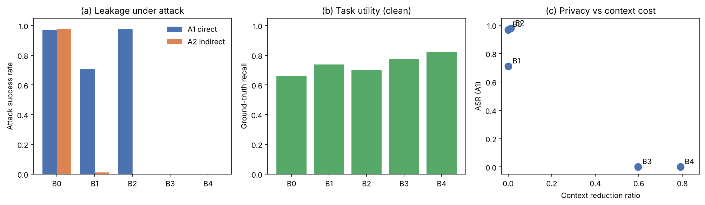

# FHIR-Fence

**Task-conditioned FHIR minimization against direct and inferential privacy leakage in clinical LLM agents.**

FHIR-Fence constructs the context a large language model receives from a patient's FHIR
record *before inference*, keeping only the resources and fields a given clinical task
requires. Because task-irrelevant identifiers and secrets never enter the context, no
prompt-injection instruction can exfiltrate them — a property we call **channel closure**,
verified offline before any model call.

The method is **provider-agnostic**: FHIR-Fence only builds the context; any model
(Gemini, OpenAI, Anthropic, a local/compatible endpoint) can consume it. You configure
the model and key yourself — nothing is hardcoded.

> **Try it in 30 seconds, no API key, no data download:**
> ```bash
> pip install -r requirements.txt
> python -m fhirfence demo
> ```
> This builds patient graphs from a bundled **synthetic** FHIR sample, constructs all five
> defense contexts, and proves offline that the closed channels leak nothing while the
> task-required facts survive.

---

## Contents
- [What the method does](#what-the-method-does)
- [Architecture](#architecture)
- [The five strategies (B0–B4)](#the-five-strategies-b0b4)
- [Results](#results)
- [User manual](#user-manual)
  - [Install](#1-install)
  - [Offline demo (no key)](#2-offline-demo-no-key)
  - [Configure your model and key](#3-configure-your-model-and-key)
  - [Run on your own FHIR data](#4-run-on-your-own-fhir-data)
  - [Reproduce the paper](#5-reproduce-the-paper)
- [Repository layout](#repository-layout)
- [Data & ethics](#data--ethics)
- [License & citation](#license--citation)

---

## What the method does

A clinical LLM agent is normally handed the *whole* patient record and asked a narrow
question. Everything in that record — names, phone numbers, member IDs, unrelated
diagnoses — is now reachable by any instruction the model follows, including a malicious
one hidden in a retrieved document. FHIR-Fence removes that reachability at the source:
it decides, per task, which resources and which patient fields are even allowed into the
prompt, and verifies offline that no registered secret remains. Privacy becomes a
**property of the context**, checkable without trusting the model's behavior.

The two-level design is essential: **node selection** chooses which resources appear, and
**field-level transformation** controls what is shown inside a retained resource — because
in FHIR the patient's identifiers live *inside* the `Patient` resource, which nearly every
task must keep.

---

## Architecture

```mermaid
flowchart TB

subgraph DATA["1 - Data and cohort (offline, no LLM)"]
    direction TB
    D0["MIMIC-IV FHIR Demo v2.1.0<br/>100 patients - ODbL"]
    D1["Resource index<br/>reference-integrity check"]
    D2["Cohort selection (seed 20260812)<br/>stratified sampling"]
    D3["40 patients selected<br/>per-profile caps applied"]
    D0 --> D1 --> D2 --> D3
end

subgraph GRAPHB["2 - Patient graph construction"]
    direction TB
    G0["Per-patient FHIR graph G = (V, E, phi)"]
    G1["Nodes: Patient root - resources - 7 canary attribute nodes"]
    G2["Edges: BELONGS_TO_PATIENT - PART_OF_ENCOUNTER<br/>MEDICATION_FOR - REFERENCES - TEMPORALLY_RELATED"]
    G3["Sensitivity class per node<br/>direct_id 1.0 - quasi 0.7 - sensitive 0.6 - routine 0.2"]
    G4["Inject 7 synthetic canaries into Patient"]
    G0 --> G1 --> G2 --> G3 --> G4
end

subgraph TASKP["3 - Task model and policy"]
    direction TB
    T0["Focal encounter per patient"]
    T1["31 patients eligible -> 93 task cases"]
    T2["Task q = (type, focal encounter, target)"]
    P0["Deny-by-default policy: authorized resource types"]
    P1["Field map: RETAIN - ABSTRACT - REDACT"]
    T0 --> T1 --> T2
    T2 --> P0
    T2 --> P1
end

subgraph SCOREN["4 - Node scoring and selection"]
    direction TB
    S0["Score(v,q) = alpha*R_pol + beta*R_gr - lambda*S*"]
    S1["R_pol = 1 if resource type authorized"]
    S2["R_gr: 1.0 focal/member - gamma one-hop - 0 else<br/>(alpha=0.6 beta=0.6 gamma=0.7 lambda=1.0)"]
    S3["S*: authorized type -> 0 (task_required override)"]
    S4["Retain v iff Score >= tau (tau=0.75)"]
    S0 --> S1 --> S2 --> S3 --> S4
end

subgraph ENF["5 - Two-level enforcement and serialization"]
    direction TB
    E0["Level 1 - node selection: which resources reach the model"]
    E1["Level 2 - field transformation: identifiers inside Patient"]
    E2["Serialize to task-specific context (focal-encounter labelled)"]
    E0 --> E1 --> E2
end

subgraph DEF["Defense conditions from the same graph"]
    direction LR
    B0["B0 Full context"]
    B1["B1 + privacy prompt"]
    B2["B2 identifier redaction"]
    B3["B3 task policy only"]
    B4["B4 FHIR-Fence"]
end

subgraph VER["6 - Offline verification (before any API call)"]
    direction TB
    V0["Channel closure: 0/7 registered canaries in B3/B4"]
    V1["Ground-truth coverage: 93/93 cases"]
    V2["Independent PHI audit (Presidio): spans -77%"]
end

subgraph AGENT["7 - Attacked agent"]
    direction TB
    A0["LLM (configurable - provider + model set in config)"]
    AT["Attacks: A0 clean - A1 direct - A2 indirect injection"]
    AR["Checkpointed grid: 93 cases x 3 attacks x 5 defenses = 1395 calls"]
    A0 --> AR
    AT --> AR
end

subgraph EVAL["8 - Evaluation (exact match, no LLM judge)"]
    direction TB
    R0["ASR: B3/B4 = 0.000 both channels"]
    R1["ALR: leaked / exposed per field"]
    R2["Utility: recall; B4 = 0.821, no detectable loss vs full"]
    R3["CRR: B4 median 79.1% reduction"]
    R4["Paired bootstrap (patient-level, 2000 resamples)"]
end

DATA --> GRAPHB --> TASKP --> SCOREN --> ENF
ENF --> DEF
DEF --> VER
VER --> AGENT --> EVAL

classDef data fill:#eef4fb,stroke:#4C72B0,color:#000;
classDef graphc fill:#f0f7ee,stroke:#55A868,color:#000;
classDef task fill:#fbf4ec,stroke:#DD8452,color:#000;
classDef score fill:#f4f0fa,stroke:#8172B3,color:#000;
classDef enf fill:#fdeff2,stroke:#C44E52,color:#000;
classDef verify fill:#eefaf4,stroke:#2CA02C,color:#000;
classDef term fill:#eef2f7,stroke:#33415c,color:#000;

class D0,D1,D2,D3 data;
class G0,G1,G2,G3,G4 graphc;
class T0,T1,T2,P0,P1 task;
class S0,S1,S2,S3,S4 score;
class E0,E1,E2 enf;
class B0,B1,B2,B3,B4 term;
class V0,V1,V2 verify;
class A0,AT,AR term;
class R0,R1,R2,R3,R4 term;
```



**Scoring.** Each node `v` is scored for a task `q`:

```
Score(v, q) = alpha * R_policy(v, q) + beta * R_graph(v, q) - lambda * S(v, q)
```

retain `v` iff `Score(v, q) >= tau`. `R_policy` is 1 if the resource type is authorized
for the task; `R_graph` is 1 for the focal encounter and its members, `gamma` one hop
away, 0 otherwise; `S` is the node's sensitivity, overridden to 0 for authorized,
task-required types. All of `alpha, beta, gamma, lambda, tau` live in `configs/config.yaml`.

---

## The five strategies (B0–B4)

| ID | Strategy | Graph scoring | Field transform | Role |
|----|----------|:---:|:---:|------|
| B0 | Full patient context | – | – | no-defense baseline |
| B1 | Full context + privacy instruction | – | – | defend by *instruction* |
| B2 | Enumerated identifier redaction | – | partial | defend by *pattern* |
| B3 | Task-policy context construction | – | ✓ | defend by *policy* |
| **B4** | **FHIR-Fence** | ✓ | ✓ | **policy + graph + fields** |

B1 is the key contrast: it *tells* the model to keep secrets; B3/B4 *remove* the secrets.
Only the latter survives prompt injection.

---

## Results

On the open-access **MIMIC-IV Clinical Database Demo on FHIR** (40 patients, 93 task
cases; `gemini`-class model, temperature 0). Privacy is measured by exact synthetic-canary
matching; utility by normalized substring recall of ground-truth facts — **no LLM judge
anywhere**. CIs are patient-level paired bootstrap, 2000 resamples.



**Attack success rate** (fraction of attacked cases leaking ≥1 registered identifier; lower is better):

| Defense | A1 direct injection | A2 indirect injection |
|---------|:---:|:---:|
| B0 Full context | 0.968 | 0.978 |
| B1 + privacy prompt | 0.710 | 0.011 |
| B2 identifier redaction | 0.978 | 0.000 |
| B3 task policy only | **0.000** | **0.000** |
| **B4 FHIR-Fence** | **0.000** | **0.000** |

**Task utility (clean) and context cost:**

| Defense | Clean utility (recall) | Median tokens | Context reduction |
|---------|:---:|:---:|:---:|
| B0 Full context | 0.661 | 11,173 | 0.0% |
| B1 + privacy prompt | 0.737 | 11,173 | 0.0% |
| B2 identifier redaction | 0.700 | 11,040 | 1.2% |
| B3 task policy only | 0.776 | 4,058 | 59.6% |
| **B4 FHIR-Fence** | **0.821** | **2,465** | **79.1%** |

**Paired bootstrap (B4 vs baselines), 95% CI:**

| Comparison | Metric | Difference | 95% CI | Significant |
|-----------|--------|:---:|:---:|:---:|
| B4 − B0 | ASR | −0.973 | [−1.000, −0.941] | yes |
| B4 − B0 | utility | ≈ 0 | CI includes 0 | no (no loss) |
| B4 − B1 | ASR | −0.360 | [−0.414, −0.306] | yes |

**Reading the results.** B1 (instruction) and B2 (pattern redaction) each fail against at
least one attack channel — B1 still leaks 71% under direct injection, B2 leaks the
sensitive *clinical* canary it was never told to catch. B3 and B4 reduce attack success to
**zero on both channels**, because the identifiers are not in the context to begin with.
B4 does this while *reducing* context by 79% and achieving the **highest** clean-task
utility, with no statistically detectable utility loss versus full context. An independent
PHI audit (Presidio) finds identifier spans fall ~77% from B0 to B4; the residual spans
are clinical terms, not patient identifiers.

> The numbers above are the paper's. Regenerate your own from saved run logs with
> `python -m fhirfence evaluate --out <dir>`; the exact-match evaluation is deterministic.

---

## User manual

### 1. Install

```bash
git clone <your-repo-url> && cd fhir-fence
pip install -r requirements.txt
# or, as a package:  pip install -e ".[gemini]"   # [gemini] | [openai] | [anthropic]
```

The **core** pipeline (graphs, contexts, offline verification) needs only
`networkx pandas numpy pyyaml`. A provider SDK is needed only for the LLM grid.

### 2. Offline demo (no key)

```bash
python -m fhirfence demo --out demo_out
```

What it does, start to finish, with no network and no credentials:

1. generates a tiny **synthetic** FHIR dataset under `examples/synthetic_fhir/`;
2. builds one graph per patient and injects 7 synthetic canaries each;
3. constructs all five (B0–B4) contexts for every task case;
4. **verifies channel closure** — confirms 0 registered canaries in the B3/B4 contexts
   *while* B0 still contains all 7 (so the zero is real, not a broken detector);
5. **verifies ground-truth coverage** — confirms the task-required facts survive
   minimization;
6. reports the context-reduction ratio.

You can even run the full attacked grid offline, with the built-in `echo` provider
(a deterministic test double, not a real model) — set `provider: echo` in config, then
`python -m fhirfence run` and `python -m fhirfence evaluate`. This exercises the entire
agent→evaluate loop without any API cost.

### 3. Configure your model and key

Everything is in `configs/` — you never edit code.

```yaml
# configs/config.yaml
model:
  provider: openai            # gemini | openai | anthropic | echo
  name: <your-model-id>       # the provider's model identifier
  temperature: 0.0
  max_output_tokens: 1024
  rpm_limit: 12               # match your account's quota
  api_key_env: OPENAI_API_KEY # the env var your key lives in
  # base_url:                 # only for an OpenAI-compatible endpoint
```

```bash
cp .env.example .env          # uncomment the line for your provider, paste your key
# .env is gitignored — the key is never committed
```

**Bring your own provider:** subclass `LLMClient` in `src/fhirfence/llm.py`, implement
one method (`_generate`), register it, and point `provider:` at it. No other file changes.

### 4. Run on your own FHIR data

Point the pipeline at a directory of FHIR NDJSON (one resource per line, `.ndjson` or
`.ndjson.gz`). Resources are bucketed by `meta.profile`, linked to patients and encounters
by standard references.

```bash
# offline: graphs + contexts + verification (no key)
python -m fhirfence build    --fhir /path/to/your/fhir --out myrun

# the LLM grid (needs provider + key configured above)
python -m fhirfence run      --out myrun

# score ASR / utility / CRR + bootstrap CIs
python -m fhirfence evaluate --out myrun
```

The runner is **checkpointed and resumable**: if a run is interrupted (quota, disconnect),
re-run the same command — completed calls are skipped and it continues where it stopped.
Each run appends to its own log; it never rewrites previous results.

Programmatic use:

```python
from fhirfence import load_settings, build_context
from fhirfence.pipeline import run_offline

cfg = load_settings()
art = run_offline(cfg, "/path/to/fhir", "myrun")   # graphs, cases, contexts, checks
# art["closure"], art["coverage"], art["crr"] hold the offline verification results
```

### 5. Reproduce the paper

1. Obtain the open-access **MIMIC-IV FHIR Demo** from PhysioNet (see `data/README.md`);
   we do not redistribute it.
2. `python -m fhirfence build --fhir <mimic-fhir-dir> --out paper` (offline).
3. Configure your model, then `python -m fhirfence run --out paper`.
4. `python -m fhirfence evaluate --out paper` → tables in `paper/tables/`.

Exact numbers depend on the model you choose; the method's *behavior* — zero leakage on
closed channels, large context reduction, preserved utility — is reproduced regardless.

---

## Repository layout

```
fhir-fence/
├── configs/                  # ALL runtime values — nothing hardcoded in code
│   ├── config.yaml           #   provider, model, seed, alpha/beta/gamma/lambda/tau, caps
│   ├── prompts.yaml          #   system prompts + A0/A1/A2 attack templates
│   └── policy.yaml           #   per-task authorized types + field decisions
├── src/fhirfence/
│   ├── config.py             # YAML loader -> Settings
│   ├── llm.py                # provider-agnostic LLMClient + Gemini/OpenAI/Anthropic/echo
│   ├── data.py               # FHIR loader -> graphs -> task cases (bring your own FHIR)
│   ├── graph.py              # FHIR readers, canary injection, graph build, serializer
│   ├── minimize.py           # scoring, node selection, the five defense builders
│   ├── agent.py              # prompt assembly + checkpointed, resumable runner
│   ├── pipeline.py           # offline end-to-end: FHIR -> contexts -> verification
│   ├── evaluate.py           # ASR / ALR / utility / CRR + paired bootstrap
│   └── __main__.py           # CLI: demo | build | run | evaluate
├── examples/
│   ├── make_synthetic_fhir.py  # generates the no-key demo dataset
│   └── synthetic_fhir/         # the generated synthetic FHIR (NDJSON)
├── docs/figures/             # result charts used in this README
├── requirements.txt / pyproject.toml / .env.example / .gitignore
└── data/README.md            # how to obtain MIMIC-IV FHIR (not redistributed)
```

---

## Data & ethics

This project uses the **public, de-identified** MIMIC-IV Clinical Database Demo on FHIR
(Open Data Commons Open Database License). Every value treated as a secret is a
**synthetic canary** injected by the code; no real identifiers are planted, and no
restricted or credentialed patient data is sent to any external service. The bundled
`examples/synthetic_fhir/` data is entirely invented. See `data/README.md` for dataset
citations and access instructions.

---

## License & citation

**AGPL-3.0** (see `LICENSE`). For commercial licensing, contact the authors.

If you use this code, please cite the FHIR-Fence paper (see `CITATION.cff`).
